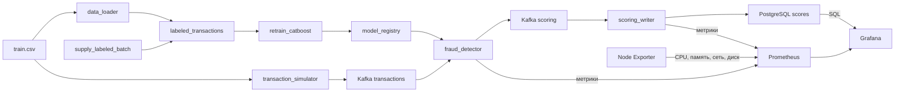

# Антифрод: поток транзакций, скоринг и переобучение

Учебный проект обнаружения мошеннических транзакций. Kafka несёт непрерывный поток событий, CatBoost скорит их текущей моделью, а Airflow по расписанию дописывает размеченные месяцы и переобучает модель.

Датасет можно найти [здесь](https://www.kaggle.com/competitions/teta-ml-1-2025/data). В этом занятии используется файл `train.csv` из каталога практики занятия 07. Путь задаётся переменной `TRAIN_DATA_CSV`.

---

## Архитектура



| Сервис | Описание |
|--------|----------|
| **Kafka** | Шина сообщений между симулятором потока, скорингом и записью результатов |
| **Zookeeper** | Управление кластером Kafka |
| **Kafka UI** | Просмотр топиков `transactions` и `scoring` |
| **transaction_simulator** | Бесконечно шлёт в `transactions` случайные строки CSV. У каждой новый `transaction_id` и `transaction_time`, равный текущему моменту, формат `YYYY-MM-DD HH:MM` |
| **fraud_detector** | Препроцессинг и инференс CatBoost. Перед каждым сообщением читает `/models/latest.txt` и подхватывает `my_catboost_<версия>.cbm` без перезапуска |
| **scoring_writer** | Читает топик `scoring` и пишет `score`, `fraud_flag` и `model_version` в PostgreSQL |
| **PostgreSQL** | Витрина `labeled_transactions`, состояние окна `training_state` и таблица `scores` |
| **data_loader** | При старте один раз загружает весь CSV в витрину и собирает исходное окно обучения: январь–март 2019 |
| **airflow** | Три DAG каждые 5 минут: поставка нового размеченного месяца, переобучение CatBoost и проверка качества данных |
| **Prometheus** | Каждую секунду собирает метрики скоринга, записи результатов и Node Exporter |
| **Grafana** | Показывает дашборды и алерты по метрикам Prometheus и данным PostgreSQL |
| **Node Exporter** | Отдаёт системные метрики CPU, памяти, сети и дисков |

Общий том `model_registry` смонтирован в Airflow как `/opt/airflow/models` и в `fraud_detector` как `/models`. Логика задач вынесена в `pipeline/`. Файлы в `dags/` только связывают задачи.

---

## Структура проекта

```
.
├── fraud_detector/           # Онлайн-скоринг
├── transaction_simulator/    # Непрерывная поставка транзакций в Kafka
├── scoring_writer/           # Запись скоров в PostgreSQL
├── data_loader/              # Первичная загрузка размеченной витрины
├── dags/
│   ├── retrain_catboost.py   # DAG переобучения
│   ├── supply_labeled_batch.py
│   └── data_quality_check.py # DAG проверки качества данных
├── pipeline/
│   ├── db.py                 # Подключение к витрине и training_state
│   ├── retrain/              # Функции задач переобучения
│   ├── supply/               # Функции задач поставки месяца
│   └── dq/                   # Функции задач проверки качества данных
├── dq_reports/               # HTML-отчёты DQ, создаётся при запуске
├── airflow/                  # Образ Airflow с CatBoost
├── prometheus/
│   └── prometheus.yml        # Сбор метрик скоринга, записи и Node Exporter
├── grafana/
│   ├── dashboards/           # Три JSON-дашборда
│   └── provisioning/
│       ├── datasources/      # Подключения к Prometheus и PostgreSQL
│       ├── dashboards/       # Автоматическая загрузка дашбордов
│       └── alerting/         # Два правила алертов
├── postgres/
│   └── grafana.sql           # Пользователь Grafana с правами на чтение
├── docker-compose.yaml
├── .env.example
└── README.md
```

Node Exporter запускается из готового образа в `docker-compose.yaml`, отдельного каталога для него нет.

---

## Что происходит после запуска

1. `data_loader` копирует `TRAIN_DATA_CSV` в `labeled_transactions` и сохраняет окно января–марта 2019. Повторный старт без `down -v` витрину не перезаливает.
2. `transaction_simulator` каждые 0.1 секунды отправляет в Kafka случайную транзакцию с текущим временем.
3. `fraud_detector` скорит поток моделью из общего каталога. До первого переобучения версия — `initial`: в каталог копируется модель из образа.
4. `scoring_writer` складывает результат в `scores`, включая `model_version`.
5. DAG `supply_labeled_batch` каждые 5 минут берёт из витрины 100 тысяч случайных строк, переносит их время в следующий календарный месяц и дописывает батч. Наблюдения старше трёх лет относительно самого нового месяца удаляются.
6. DAG `retrain_catboost` каждые 5 минут забирает следующий месяц витрины, начиная с апреля 2019, сдвигает трёхмесячное окно и учит CatBoost. Затем сравнивает свежую модель с моделью из прода и публикует `my_catboost_<timestamp>.cbm`, только если она не хуже. Подробности — в разделе [Проверка модели перед публикацией](#проверка-модели-перед-публикацией).
7. DAG `data_quality_check` каждые 5 минут проверяет текущее окно обучения по правилам качества данных и пишет HTML-отчёт в `dq_reports/`. Подробности — в разделе [Проверка качества данных](#проверка-качества-данных).

Переобучение и поставка идут по разным указателям месяца. `retrain_catboost` читает исторические месяцы с апреля 2019. `supply_labeled_batch` каждый раз создаёт месяц после максимальной даты витрины, первый такой месяц — апрель 2020. Окно обучения ещё долго не доходит до этих батчей, и очистка трёх лет его не затрагивает.

Все DAG можно запустить вручную в Airflow, не дожидаясь расписания. Если очередного месяца в витрине ещё нет, задачи переобучения помечаются как skipped.

---

## Проверка модели перед публикацией

Свежая модель попадает в прод, только если на новом месяце она не хуже текущей.

1. `fit_catboost` учит модель на двух ранних месяцах окна. Свежий месяц, test, в обучении не участвует.
2. На этом же test скорятся обе модели: свежая и модель из `latest.txt`. Старый `metrics.json` модели из прода не используется: доля и характер фрода от месяца к месяцу меняются, и метрики разных месяцев несравнимы.
3. Сравнивается PR-AUC. Фрода около 0.5%, и ROC-AUC почти не различает модели, у всех около 0.97.
4. Если PR-AUC свежей модели ниже, `publish_model` удаляет черновик и не трогает `latest.txt`. Окно и `training_state` сдвигаются в любом случае, иначе DAG застрял бы на одном месяце.

Первая обученная модель публикуется без сравнения.

Обе метрики и решение видно в логе задачи `fit_catboost`. У опубликованной модели они есть и в `metrics.json`: поля `pr_auc`, `previous_version`, `previous_pr_auc`.

---

## Проверка качества данных

DAG `data_quality_check` проверяет окно обучения `current.parquet`, то есть ровно те три месяца, на которых учится следующая модель.

1. `check_dataset` применяет правила ниже и считает нарушения.
2. `publish_dq_report` пишет HTML-отчёт в `/opt/airflow/dq_reports`. Это каталог рядом с каталогом моделей `/opt/airflow/models`, он смонтирован в папку `dq_reports/` проекта. Если нарушено хотя бы одно правило, задача падает уже после записи отчёта, и запуск в Airflow становится красным.

| № | Правило | Требование | Что ловит |
|---|---------|------------|-----------|
| 1 | Полнота | Ни в одной колонке нет пропусков | Обрыв загрузки, сломанный `COPY` в витрину |
| 2 | Уникальность | Нет полностью одинаковых строк | Повторную дозапись батча, копии строк при сэмплировании |
| 3 | Метка | `target` принимает только 0 и 1 | Ошибки разметки |
| 4 | Сумма | `amount` больше нуля | Битые и отрицательные суммы |
| 5 | Координаты | Широта в [-90, 90], долгота в [-180, 180] у клиента и мерчанта | Перепутанные или испорченные координаты, от которых зависит признак `haversine` |
| 6 | Окно | Ровно три подряд идущих календарных месяца | Сбой сдвига окна: пропущенный или лишний месяц |
| 7 | Доля фрода | Доля `target = 1` от 0.1% до 2% | Ошибки разметки |


---

## Технологии

- **Python 3.11**
- **ML**: CatBoost, pandas, numpy
- **Kafka**: потоковая обработка данных
- **PostgreSQL**: витрина размеченных данных и результаты скоринга
- **Airflow 2.10**: поставка месячных батчей и переобучение модели
- **Prometheus**: сбор и хранение метрик сервисов
- **Grafana**: дашборды и алерты, визуализация метрик Prometheus и данных PostgreSQL
- **Node Exporter**: системные метрики CPU, памяти, сети и дисков
- **Docker / Docker Compose**: оркестрация микросервисов

---

## Как запустить проект

### 1. Откройте каталог проекта

```bash
cd mlops_monitoring
```

### 2. Создайте `.env` файл

```bash
cp .env.example .env
```

Положите размеченный `train.csv` в корень проекта или укажите его абсолютный путь в `TRAIN_DATA_CSV`. CSV не входит в Git; ссылка на датасет приведена выше.

### 3. Запустите контейнеры

```bash
docker compose up -d --build
```

Нужны [Docker](https://docs.docker.com/engine/install/) и Docker Compose. Первый запуск скачивает образы и загружает витрину, это занимает несколько минут.

## Доступные сервисы

| Сервис | URL |
|--------|-----|
| **Kafka UI** | http://localhost:8080 |
| **Airflow** | http://localhost:8081 (`admin` / `admin`) |
| **PostgreSQL** | `localhost:5432`, база `fraud_db` |
| **Grafana** | http://localhost:3000 (`admin` / `admin`) |
| **Prometheus** | http://localhost:9090 |
| **Node Exporter** | http://localhost:9100/metrics |
| **Метрики скоринга** | http://localhost:8000/metrics |
| **Метрики записи результатов** | http://localhost:8001/metrics |

Пользователь и пароль Postgres задаются в `.env` (`fraud_user` / `fraud_pass` в шаблоне).

Посмотреть витрины из контейнера:

```bash
docker compose exec postgres psql -U fraud_user -d fraud_db
```

---

## Таблицы PostgreSQL

Таблица `scores`:

| Поле | Тип | Описание |
|------|-----|----------|
| id | SERIAL | Уникальный ID |
| transaction_id | TEXT | Идентификатор транзакции |
| score | FLOAT | Вероятность мошенничества, порог 0.5 |
| fraud_flag | INT | 1, если score больше 0.5, иначе 0 |
| model_version | TEXT | Версия CatBoost, которая посчитала скор |
| created_at | TIMESTAMP | Время записи |

`labeled_transactions` — витрина размеченных транзакций. `training_state` хранит границы трёхмесячного окна обучения и месяц следующего батча.

Последние скоры:

```sql
SELECT transaction_id, score, fraud_flag, model_version, created_at
FROM scores
ORDER BY created_at DESC
LIMIT 20;
```

Модели, которые опубликовал DAG:

```bash
docker compose exec airflow ls -la /opt/airflow/models
```

---

## Как смотреть демонстрацию

1. В Kafka UI топик `transactions` пополняется каждые 0.1 секунды, топик `scoring` — ответами модели.
2. В Airflow откройте `supply_labeled_batch` и `retrain_catboost`. Кнопка Trigger запускает прогон сразу.
3. После публикации модели новые сообщения в `scores` получают свежий `model_version`.
4. Если свежая модель хуже, `model_version` в `scores` не меняется, а в логе `publish_model` есть предупреждение «не опубликована».
5. Отчёты о качестве данных открываются в браузере прямо из папки `dq_reports/` проекта.

### Очистка

`docker compose down -v` удаляет контейнеры вместе с витриной, окном обучения, реестром моделей и состоянием Airflow. Следующий запуск снова загрузит CSV. Папка `dq_reports/` лежит на диске и не удаляется, её можно очистить вручную.

## Мониторинг

Prometheus собирает метрики каждую секунду. Источники Prometheus и PostgreSQL, три собственных дашборда и два алерта подключаются через provisioning при запуске. PostgreSQL доступен Grafana только на чтение.

- Grafana: http://localhost:3000, `admin` / `admin`.
- Prometheus: http://localhost:9090; все три цели на http://localhost:9090/targets должны быть `UP`.
- Метрики скоринга: http://localhost:8000/metrics; записи: http://localhost:8001/metrics; Node Exporter: http://localhost:9100/metrics.

| Дашборд | Что смотреть |
|---|---|
| [Обработка транзакций](http://localhost:3000/d/fraud-scoring) | TPS, p95 обработки, доля фрода, тепловая карта скоров, отметки новой модели, число скоров и доля фрода по версиям из PostgreSQL |
| [Запись результатов](http://localhost:3000/d/fraud-writer) | TPS записи, p95 INSERT с COMMIT, число фродовых транзакций, тепловая карта записанных скоров |
| [Системные метрики](http://localhost:3000/d/fraud-system) | CPU, память, входящий/исходящий трафик, заполнение дисков и дисковый ввод-вывод |

На первом дашборде фильтры `us_state` и `merch` совместно меняют SQL-графики плотности скоров и TPS (число записей за 5 секунд / 5), таблицу версий и barplot категорий. Плотность - доля скоров в интервале / ширина интервала 0.05. Barplot показывает средний `fraud_flag` по `cat_id` среди последних 1000 записей всего потока, затем применяет фильтры; остальные SQL-панели учитывают выбранный диапазон времени. Общие технические метрики Prometheus относятся ко всему потоку.

| Метрика | Назначение |
|---|---|
| `scoring_transactions_total` | Успешно обработанные и опубликованные скоры |
| `scoring_processing_seconds` | Гистограмма времени обработки, включая доставку в Kafka |
| `scoring_score` | Гистограмма вероятностей фрода |
| `scoring_fraud_total`, `scoring_fraud_ratio` | Число фродовых транзакций и доля с запуска; график показывает долю за последнюю минуту |
| `scoring_model_loads_total{version}` | Число успешных загрузок каждой версии, увеличивается при горячей смене модели |
| `scoring_model_reloaded_timestamp_seconds{version}` | Время горячей смены; отметка "Модель <версия>" длится 30 секунд и остаётся в истории графика |
| `scoring_amount_total{fraud}` | Дополнительная метрика, которой нет в семинаре: сумма обработанных платежей по флагу фрода. График «Сумма подозрительных платежей в минуту» показывает денежный объём риска, который не виден по одному числу транзакций |
| `scoring_errors_total` | Ошибки обработки сообщений |
| `writer_scores_total`, `writer_fraud_total` | Число записанных скоров и выявленного фрода после COMMIT |
| `writer_write_seconds`, `writer_score` | Гистограммы времени записи и записанных вероятностей |
| `node_cpu_seconds_total`, `node_memory_*`, `node_network_*`, `node_filesystem_*`, `node_disk_*` | Системные метрики Node Exporter |

У гистограмм доступны серии `_bucket`, `_sum`, `_count`.

### Проверка потока и новой модели

После старта дождитесь завершения `data_loader` и появления данных (обычно несколько минут). Сравните `scoring_transactions_total` и `writer_scores_total` на страницах метрик с интервалом 10 секунд: оба счётчика растут, графики обновляются каждые 5 секунд. В SQL-панелях выберите штат и мерчанта из выпадающих списков; `All` снимает ограничение.

Для проверки переобучения:

```bash
docker compose exec airflow airflow dags trigger retrain_catboost
docker compose exec airflow cat /opt/airflow/models/latest.txt
```

Дождитесь успешной задачи `publish_model` в Airflow (http://localhost:8081, `admin` / `admin`). После публикации файла и следующей транзакции на первом дашборде появляется фиолетовая отметка с версией, а в SQL-таблице — новая строка. Контейнер скоринга не перезапускается. Первая обученная модель публикуется обязательно; последующие могут быть отклонены сравнением PR-AUC. В таком случае запустите следующий прогон и проверьте лог `publish_model`.

### Проверка алертов

Правила находятся в `grafana/provisioning/alerting/rules.json`, раздел Grafana [Alert rules](http://localhost:3000/alerting/list). Два правила: «Поток скоринга остановился» и «Запись скоров остановилась». Порог каждого - менее 0.01 транзакции/с за последние 30 секунд непрерывно в течение ещё 30 секунд, оценка каждые 10 секунд. Отсутствие данных или ошибка запроса тоже вызывает алерт.

```bash
docker compose stop transaction_simulator
```

После обработки остатка Kafka и примерно 70 секунд оба алерта переходят в `Firing`. Для восстановления:

```bash
docker compose start transaction_simulator
```

После возобновления потока алерты возвращаются в `Normal`.
